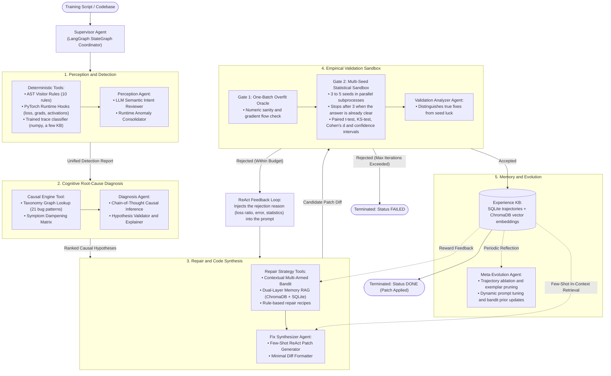
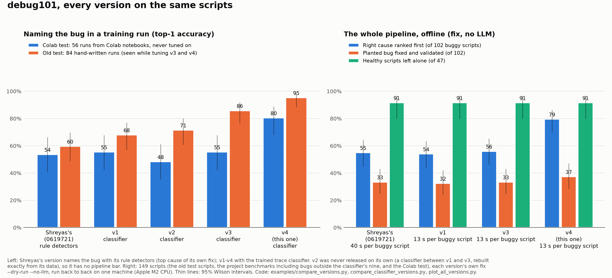
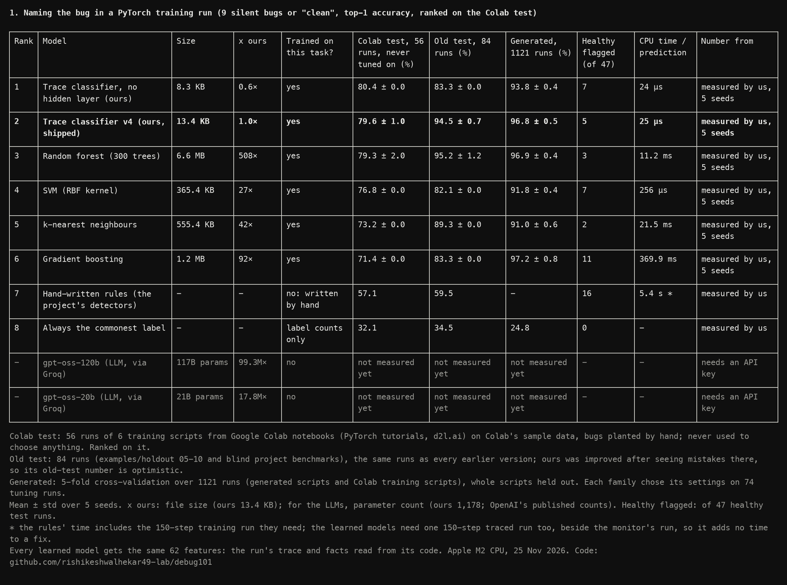
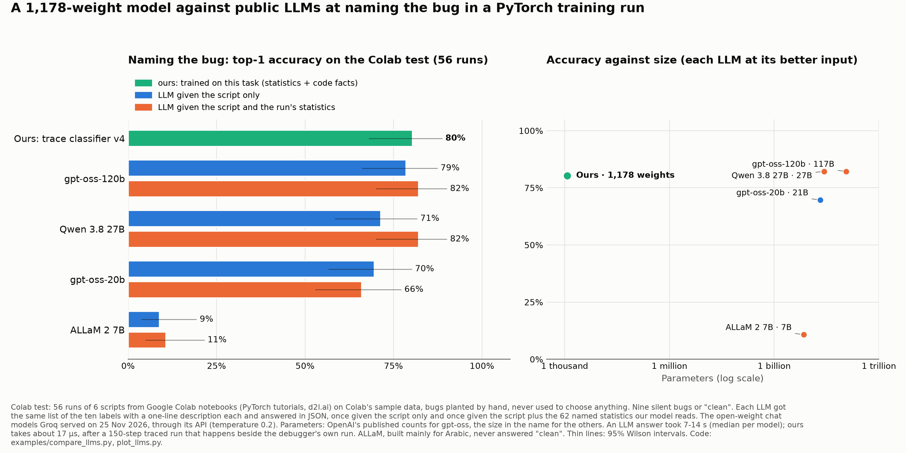
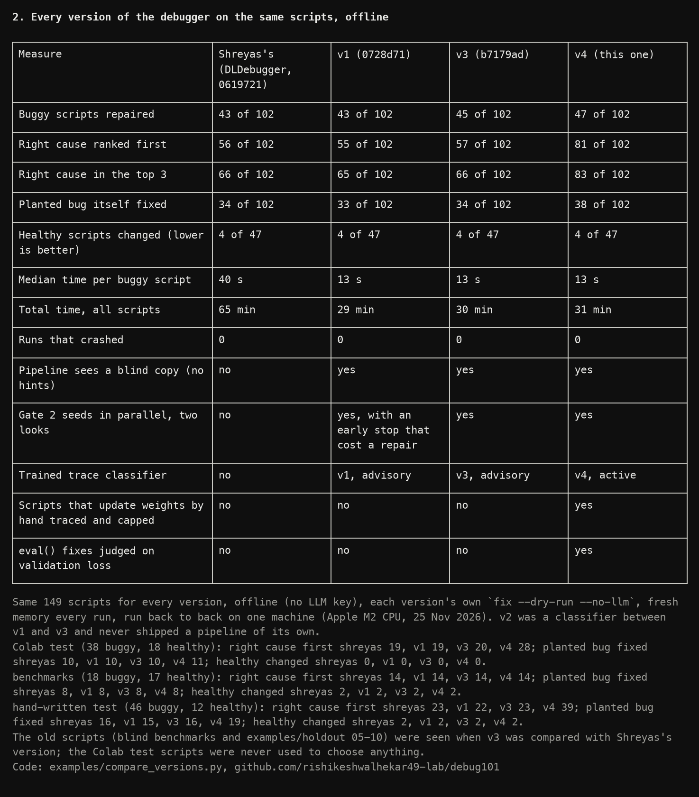

# Deep Learning Debugger (`silent-bug-agent`)

An autonomous multi-agent system that **detects, diagnoses, and fixes silent bugs in deep learning training**: the kind where the code runs without errors, the loss even goes down, and the model still doesn't learn what you think it does.

---

## Why This Exists

Crashes are easy: you get a traceback. Silent bugs are not. Examples:

* `model.eval()` never called before validation, so BatchNorm and Dropout keep behaving as in training
* A layer that is trainable but was left out of the optimizer, so it never updates
* `optimizer.zero_grad()` missing, so gradients accumulate across batches
* Softmax applied before `CrossEntropyLoss` (which internally applies LogSoftmax)
* Features and labels shuffled independently
* Missing input normalization, or a learning rate that is far too high
* Dead ReLUs silently killing gradient propagation

Nothing raises an exception. You just get a worse model and hours of wasted compute. This project automates the entire detection, diagnosis, repair, and empirical validation pipeline.

---

| Agent | What it does |
|---|---|
| **Supervisor** | LangGraph StateGraph orchestrator, state transitions & lifecycle |
| **0** | Bug taxonomy (21 seed patterns) + runtime invariant library |
| **1** | PyTorch hooks, live runtime monitor agent, profiling & alerts |
| **2** | AST static analyzer + LLM semantic reviewer + unified CLI |
| **3** | One-batch-overfit oracle + multi-seed statistical validation sandbox |
| **4** | Root-cause diagnosis & causal dampening graph + LLM reasoning |
| **5** | Fix synthesizer agent (MAB bandit + ReAct LLM patch generation) |
| **6** | Experience memory (knowledge base store + contextual bandit routing) |
| **7** | Meta-evolution self-reflective agent (prompt tuning & exemplar pruning) |

---

## Multi-Agent Architecture

The system is built as a **cooperative multi-agent ecosystem** orchestrated by a central **LangGraph StateGraph** (`silent_bug_agent/agents/supervisor.py`). Every stage operates as a **Hybrid Node**: deterministic tools (AST analysis, PyTorch telemetry hooks, causal inference, sandboxed execution) combined with LLM agents for semantic perception, causal reasoning, code synthesis and verdict analysis.



### Hybrid Node Workflow

Each stage in the LangGraph execution flow follows a two-phase execution:
1. **Deterministic Phase (Sensory and Metric Tools)**: high-speed tools run directly on code and tensors to collect ground truth (AST violation lines, gradient norms, causal dampening weights, loss curves from real runs).
2. **Cognitive Phase (LLM Agents)**: LLM prompts (Groq `openai/gpt-oss-120b` and `openai/gpt-oss-20b`, with Cerebras `gpt-oss-120b` and `qwen-3.8-27b` as backup) read the tool outputs, reason about cause and effect, and return strict-JSON decisions to the LangGraph state.

The full model list for each agent is in [docs/models_and_apis.md](docs/models_and_apis.md).

### Key Architectural Principles:
- **Statistical, Not Formal**: Training is stochastic. Correctness is measured with paired t-tests, Kolmogorov-Smirnov tests, Cohen's $d$, confidence intervals and loss ratios across multiple seeds.
- **Hierarchical Validation Gates**: Patches must pass a cheap numeric filter (Gate 1: one-batch overfit on the real script) before the expensive multi-seed sandbox (Gate 2).
- **Do No Harm**: A patch is accepted only if it improves results significantly, or removes a detected warning-level bug without making results worse. An informational hint must prove itself with statistics. The LLM can veto an acceptance but can never overrule a rejection.
- **ReAct Feedback-Driven Repair**: If a candidate fails a gate, the exact reason (exception, loss ratio, p-value) is fed into the Fix Synthesizer's next prompt.
- **Dual Memory & Self-Evolution**: Successful repairs are embedded in ChromaDB for retrieval in future repairs. The Meta-Evolution agent prunes examples that make results worse and rolls back prompt lessons that lower the success rate.
- **Zero-Key Fallbacks**: Runs live with free `GROQ_API_KEY` / `CEREBRAS_API_KEY` keys, or fully without keys using rule-based repair recipes. The run report always states which models were used, or that none were.
- **No GPU needed**: everything runs on a CPU, including validation.

---

## Quick Start

Requires Python 3.10 or newer (3.12 recommended). Works on Windows, Linux and macOS.

```bash
# 1. Get the code
git clone https://github.com/shreyasshah707/AgenticDLDebugger.git
cd AgenticDLDebugger

# 2. Setup virtual environment
python -m venv .venv
# Linux/macOS:
source .venv/bin/activate
# Windows:
.venv\Scripts\activate

# 3. Install dependencies
pip install -e ".[torch,semantic,dev]"

# 4. Check the installation, keys and models
python -m silent_bug_agent doctor
```

[SETUP.md](SETUP.md) has the longer walkthrough, including the optional terminal UI (needs Node.js).

---

## LLM API Keys & Environment Setup

The system works without keys, using rule-based recipes and statistics. Add a free key to turn on the LLM agents.

Copy `.env.example` to `.env`:
```bash
cp .env.example .env          # Windows: copy .env.example .env
```

Edit `.env`:

```dotenv
# --- Groq (main provider, free tier): https://console.groq.com/keys ---
GROQ_API_KEY=paste_your_groq_key_here

# --- Cerebras (backup provider, free tier): https://cloud.cerebras.ai ---
CEREBRAS_API_KEY=paste_your_cerebras_key_here
```

> **Priority**: each agent tries **Groq** $\rightarrow$ **Cerebras** $\rightarrow$ **offline rules**. When Groq's free limit is reached, the same request goes to Cerebras.

Then confirm both keys answer:
```bash
python -m silent_bug_agent doctor --live
```

---

## CLI Usage

The CLI has four core commands (`scan`, `monitor`, `diagnose`, `fix`), plus `snippet`, `apply`, `wsp`, `doctor` and `ui`. Arguments for your own script go after `--`.

> **The bundled examples are protected.** The tests and the results below depend on the bugs planted in `examples/`, so those files are never edited. `fix` validates and shows the patch, and `apply` writes the fixed version to `fixed_examples/<name>.py` instead. To have a file patched in place, work on your own script or a copy:
> ```bash
> cp examples/sample_scripts/buggy_mnist.py my_train.py      # Windows: copy examples\sample_scripts\buggy_mnist.py my_train.py
> ```

### 1. Static & Semantic Code Scan (`scan`)
```bash
# Static AST scan
python -m silent_bug_agent scan examples/sample_scripts/buggy_mnist.py

# Static + LLM Semantic Review (uses GROQ_API_KEY or CEREBRAS_API_KEY from .env)
python -m silent_bug_agent scan examples/sample_scripts/buggy_mnist.py --semantic

# Output machine-readable JSON for CI/CD
python -m silent_bug_agent scan examples/sample_scripts/buggy_mnist.py --json
```

### 1b. Code snippets (`snippet`, static only)
For a fragment rather than a whole script: a few lines pasted from a notebook, a chat or a code review. The parser removes markdown fences and `>>>` prompts, removes common indentation, wraps the code in a function when it needs one, and drops an unfinished last line, and it says which of these it did. Line numbers in the findings point at the pasted text.
```bash
python -m silent_bug_agent snippet examples/snippets/training_step.txt
pbpaste | python -m silent_bug_agent snippet              # macOS clipboard
Get-Clipboard | python -m silent_bug_agent snippet        # Windows PowerShell
```
A snippet is read, never run, so its findings are **not validated**: the report says so on every run. To test a repair, run `fix` on the full training script. In the terminal UI this is the **SNIPPET** entry.

### 1c. The trace classifier (a small model trained in this project)
`fix` and `diagnose` also run the script once, traced for 150 steps, at the same time as the runtime monitor's run, and a small model gives its guess: `Trace classifier (a trained model; a hint, not proof): missing_zero_grad 0.98, ...`. Version 4 reads 62 numbers: statistics of the run, including every `backward()` call, so scripts that update weights by hand are covered too, and facts read from the code. It is a numpy network with one hidden layer of 16 units: 1,178 weights, a 16.5 KB file, about 17 µs a prediction. It was trained on 1,121 runs of generated scripts and of scripts from Google Colab notebooks, with planted bugs.

On a new test set nothing was tuned on, 56 runs of six Colab-notebook scripts (the PyTorch tutorials and d2l.ai, on Colab's sample data), it names the bug (or "clean") **80.4%** of the time. Versions 1 to 3 got 48% to 55% on the same runs. On the older 84-run test it gets 95.2% (v3: 85.7%), but that set has been seen, so quote the Colab number. Against other models given the same features and the same tuning (mean of 5 seeds), it ties with a random forest 500 times its size on the Colab test (79.6% against 79.3%). The rules alone get 57%. Against public LLMs on the same runs it also ties. gpt-oss-120b and Qwen 3.8 27B reach 82% only when they are given its run statistics as well as the script, and from the script alone the best LLM gets 79% (`examples/compare_llms.py`, chart below). It flags 5 of 47 healthy test runs. Because it now helps (on the tuning scripts, right cause first 47 of 54 instead of 32, and no healthy script changed), `fix` and `diagnose` let it take part by default: a confident guess becomes a finding and its probabilities nudge the ranking of causes. `--learned advisory` only shows the guess, and `--learned off` skips it. Every patch still has to pass both gates.







How it was built, the Colab scripts, the label check, every model and version it was compared with, and how often the test set was looked at: [docs/learned_classifier.md](docs/learned_classifier.md).

### 2. Live Runtime Monitoring (`monitor`)
Runs a training script under PyTorch inspection hooks to catch gradient explosions, loss divergence, frozen layers and more:
```bash
python -m silent_bug_agent monitor examples/sample_scripts/benchmark_01_missing_zero_grad.py
```

### 3. Root-Cause Diagnosis (`diagnose`)
Runs detection and ranks root-cause hypotheses with confidence scores:
```bash
python -m silent_bug_agent diagnose examples/sample_scripts/buggy_mnist.py
```

### 4. Autonomous Repair Pipeline (`fix`, then `apply`)
Runs the full supervisor loop: detection $\rightarrow$ diagnosis $\rightarrow$ patch synthesis $\rightarrow$ validation. There are two ways to use it:

```bash
# Review first (recommended): validate a patch, show it, change nothing
python -m silent_bug_agent fix my_train.py --dry-run
# ...then write exactly the patch that was validated and shown
python -m silent_bug_agent apply my_train.py

# Not happy with the patch? Turn it down and look for a different one
python -m silent_bug_agent fix my_train.py --dry-run --another

# Or in one step: validate and write, for up to --max-rounds (3) bugs
python -m silent_bug_agent fix my_train.py --max-iter 3
```

`--another` never offers a patch you turned down again. With an LLM key the model is told what was declined and asked for a different change. Without a key each bug has one rule-based fix, so the answer is usually "no other fix", or a fix for a different bug in the same script.

Whenever a file is written, the original is kept beside it as `<name>.py.orig`. `apply` refuses if the script changed after the patch was validated.

A `fix` run fixes one bug per round, re-detecting each time; `--dry-run` stops after the first. On a CPU each round takes about 1 to 2 minutes for the sample scripts, mostly spent on the 10 training runs of Gate 2.

### 5. Weight inspection (`wsp`, read-only)
Looks at a model's numbers for signs of a training bug that the code does not show: NaN or exploded values, a weight matrix stuck at zero, biases so negative that a ReLU cannot fire, and collapsed rank. It only reads. It never changes a script or a checkpoint; a repair belongs in the code, where `fix` can test it.

```bash
# Train the script for 60 steps in the sandbox, then inspect the weights it produced
python -m silent_bug_agent wsp examples/sample_scripts/benchmark_06_dead_relu.py

# Or inspect a saved state_dict (loaded with weights_only=True, so a pickle cannot run code)
python -m silent_bug_agent wsp --checkpoint model.pt --json
```

### 6. Installation check (`doctor`)
```bash
python -m silent_bug_agent doctor          # libraries, .env, keys, model per task
python -m silent_bug_agent doctor --live   # also sends one tiny request to each model
```

### 7. Terminal UI (`ui`, optional)
A keyboard-driven front end over the same commands, built with Ink. It needs Node.js 18 or newer:
```bash
cd tui && npm ci && npm run build && cd ..
python -m silent_bug_agent ui
```
Its Fix screen always validates first, then asks: apply the fix, do not apply, or try another fix. Those run the `apply` and `--another` commands above.

---

## Results

`python examples/evaluate_pipeline.py --offline --new` runs all 18 benchmarks through the full pipeline on private copies: once buggy, and once healthy (as if run with `--fix`), to measure the damage rate too. **The pipeline sees blind copies**, saved as `train.py`: the docstring, the `# BUG:` comments, the `--fix` switch and the benchmark's name are all removed (`silent_bug_agent/mutation/blind.py`), so nothing in the file gives the bug away. Offline, the rules do not use those hints: the summary for 01 to 08 (8, 8 and 7 of 8 below) is the same as in the earlier evaluation of the raw files.

Measured on 24 November 2026, offline (no LLM key), CPU only (Apple M2), 5 seeds per arm, trace classifier advisory:

| Benchmark | Planted bug | Fixed | Bug the accepted patch fixed | p-value | Time | Healthy twin |
|---|---|---|---|---|---|---|
| 01 | missing `zero_grad()` | yes | missing_zero_grad | 0.005 | 26 s | left alone |
| 02 | `model.eval()` missing | yes | train_eval_mode_mismatch | 0.004 | 22 s | left alone |
| 03 | layer left out of the optimizer | yes | frozen_layer_no_grad | 0.007 | 18 s | left alone |
| 04 | softmax before CrossEntropyLoss | yes | softmax_before_cross_entropy | 0.0003 | 28 s | edited (harmless, see below) |
| 05 | learning rate 50 | yes | learning_rate_misconfigured | < 0.0001 | 19 s | left alone |
| 06 | dead ReLUs from bias −100 | yes | dead_relu | 0.002 | 21 s | left alone |
| 07 | `reduction="sum"` | yes | learning_rate_misconfigured (symptom) | 0.087 | 40 s | left alone |
| 08 | unnormalised inputs | yes | non_normalized_inputs | 0.003 | 22 s | left alone |

- **Benchmarks 01 to 08:** repaired 8 of 8, right cause ranked first 8 of 8, accepted patch fixed the planted bug itself 7 of 8.
- **Benchmarks 09 to 18 (harder):** repaired 1 of 10 (15, exploding gradients), right cause ranked first 6 of 10. Offline there is no repair recipe for 09 to 13, so they are found but not fixed; 14, 17 and 18 are not detected at all. These are the ones that need an LLM.
- **All 18:** repaired 9, right cause first 14, planted bug itself fixed 8. **Healthy scripts changed: 2 of 17** (09 has no healthy twin: its `--fix` changes nothing).
- **Benchmark 07:** the real fix (`reduction="mean"`) was tried first and rejected, because on this benchmark it gave no significant gain. The accepted patch lowers the learning rate instead, which offsets the summed loss. It passed because the critical learning-rate finding disappeared and results did not get worse.
- **Healthy twin of 04:** the softmax line is still in the file, in a branch that never runs. The patch removed it, which changes no behaviour.
- **Healthy twin of 16 (a false positive):** the dead-ReLU detector fired on the healthy version and a bias-initialisation patch was accepted on the "bug removed and not worse" route (p = 0.055). The code was changed without a measured need.
- **`buggy_mnist.py` (three bugs):** round 1 fixes softmax-before-CrossEntropyLoss (p < 0.0001). The missing `zero_grad()` fix is then rejected: on this script, accumulating gradients makes training *faster* over the first 200 steps, so a statistical gate on training loss cannot show the fix is better.
- The LLM agents were tested against a local fake provider. Their live repair rate has not been measured yet.

### Where the time goes, and what was done about it

Every `fix` run now ends with a `Time:` line, and the `--json` result has a `timings` block for each stage (`perception.monitor`, `validation.gate1`, `validation.gate2`, `validation.bug_check`, `llm`, ...). Timing one offline run showed where the time went: **validation took 94% of it, and Gate 2 alone 80%** (50 of 63 seconds on benchmark 01). An LLM call takes about a second; a validation run takes several. So a faster or local model would barely change how long a run takes, and the work went into validation instead:

| Change | Effect |
|---|---|
| Gate 2 runs its seeds in parallel subprocesses (about half the cores; one at a time for a script that writes files or downloads data) | Gate 2: 50 s → 16 s |
| Baseline runs are cached per seed and reused for every candidate | a second candidate costs only its own runs |
| With 5 seeds, Gate 2 looks twice: after 3 seeds it stops if the fix is already clearly better (p < 0.01); otherwise all 5 run and the final level is p < 0.04, so the false-accept rate stays at or below 5%. (It used to stop early for "no improvement so far" too; that cost one repair in the version comparison and was removed.) | 4 of 10 runs saved on clear fixes |
| The bug check runs at the same time as Gate 2 instead of after it | about 4 s |
| `script_runner` no longer imports scipy and the agents in every child process | 1 s off each of the ~13 runs (start-up 2.6 s → 0.06 s before torch) |

Benchmark 01 offline, Apple M2, 8 cores: **63 s → 22 s**, with the same accepted patch and the same p-value (0.0052). Benchmark 04: 61 s → 21 s (p = 0.00035 both times).

### Every version on the same scripts

`examples/compare_versions.py` runs checkouts of the debugger on the same 149 scripts, offline, each with its own `fix --dry-run --no-llm` and a fresh memory, back to back on one machine. The scripts are the blind benchmarks with their healthy twins, the 58-run hand-written test set, and the 56-run Colab test set. The versions are Shreyas's (DLDebugger, `0619721`), v1 (`0728d71`), v3 (`b7179ad`) and v4.




| | Shreyas's | v1 | v3 | v4 |
|---|---|---|---|---|
| Right cause ranked first (of 102 buggy) | 56 | 55 | 57 | **81** |
| Planted bug fixed | 34 | 33 | 34 | **38** |
| Healthy scripts changed (of 47) | 4 | 4 | 4 | 4 |
| Median time per buggy script | 40 s | 13 s | 13 s | 13 s |

- **What made the difference.** In v4 the classifier takes part in ranking causes. On the Colab test scripts, which nothing was tuned on, v4 ranks the right cause first for 28 of 38 buggy scripts, against 19 to 20 for the earlier versions.
- **Repair did not keep up.** The planted bug is fixed in 11 of 38, against 10. The repair recipes, not the diagnosis, are now what limits a fix offline. They do not fit notebook-style code, such as weights updated by hand or training loops inside functions.
- **Healthy scripts.** Every version changes the same 4 healthy scripts:
  - the healthy twins of benchmarks 04 and 16 (see Results above);
  - two healthy versions of `holdout_09`, which clears gradients by hand (`p.grad = None`). The rule detector for a missing `zero_grad()` still fires on them, although the v4 classifier no longer does. The next fix belongs in that rule.
- **Speed.** All the newer versions are about 3 times faster than Shreyas's.
- **The old scripts are not blind for v3 and v4.** They were seen when v3 was compared with Shreyas's version. The Colab test scripts were never used to choose anything.

---

## Repository Structure

```
AgenticDLDebugger/
├── .env.example                      # Template for Groq/Cerebras keys
├── pyproject.toml                    # Package metadata & entrypoints
├── SETUP.md                          # Step-by-step installation, including the terminal UI
├── .github/workflows/tests.yml       # CI: the test suite on Linux and Windows, and the TUI build
├── docs/
│   ├── models_and_apis.md            # Model per agent, providers, free limits
│   ├── module1_runtime_hooks.md      # Module 1 hooks design
│   ├── runtime_monitor_agent.md      # Module 1 agent design
│   ├── overhead_benchmark.md         # Module 1 overhead benchmark
│   └── ARCHITECTURE.md, THREAT.md…   # Design notes: architecture, flow, threats, failure modes, decisions
├── tui/                              # Optional terminal UI (TypeScript, Ink + Pastel)
├── silent_bug_agent/                 # Core package
│   ├── cli.py                        # Unified CLI (scan, monitor, diagnose, fix, apply, wsp, doctor, ui)
│   ├── events.py                     # NDJSON events the terminal UI reads (--events)
│   ├── config.py                     # .env loading, memory folder
│   ├── findings.py                   # Standardized Finding and Report schemas
│   ├── schemas.py                    # Multi-agent state machine contracts
│   ├── supervisor.py                 # Validation pipeline coordinator
│   ├── invariants/                   # Module 0: Invariant check library
│   ├── taxonomy/                     # Module 0: Silent bug YAML taxonomy
│   ├── runtime/                      # Module 1: PyTorch hooks, profiling, session
│   ├── static/                       # Module 2: 10 AST-based static bug rules; snippet.py checks code fragments
│   ├── semantic/                     # Module 2: LLM reviewer, Groq/Cerebras client, model router
│   ├── validation/                   # Module 3: Overfit oracle, multiseed sandbox, script runner, analyzer
│   ├── diagnosis/                    # Module 4: causal engine, taxonomy graph, bridge to the bug list
│   ├── repair/                       # Module 5: Patch application, AST repair recipes, pending patches for `apply`
│   ├── wsp/                          # Read-only weight inspector
│   ├── mutation/                     # Blind benchmark copies, generated healthy scripts, bug-planting operators, dataset builder
│   ├── learned/                      # Trace classifier: tracer, features, numpy model, training script, shipped weights.json
│   ├── learning/                     # Module 6: ChromaDB experience store & bandit
│   └── agents/                       # Autonomous agent nodes:
│       ├── supervisor.py             # Central orchestrator state machine (LangGraph)
│       ├── runtime_monitor_agent.py  # Module 1 live inspection agent
│       ├── diagnosis_agent.py        # Module 4 causal ranking agent
│       ├── fix_synthesizer_agent.py  # Module 5 patch generation agent
│       ├── meta_evolution.py         # Module 7 self-reflection agent
│       └── prompts.py                # Prompts and strict JSON schemas
├── examples/
│   ├── sample_scripts/
│   │   ├── buggy_mnist.py            # Three bugs; downloads MNIST, or uses random digits offline
│   │   ├── clean_mnist.py            # Reference clean script
│   │   ├── benchmark_01_missing_zero_grad.py
│   │   ├── benchmark_02_train_eval_mode.py
│   │   ├── benchmark_03_frozen_layer.py
│   │   ├── benchmark_04_softmax_before_crossentropy.py
│   │   ├── benchmark_05_learning_rate_too_high.py
│   │   ├── benchmark_06_dead_relu.py
│   │   ├── benchmark_07_wrong_loss_reduction.py
│   │   └── benchmark_08_unnormalized_inputs.py
│   ├── new/                          # Benchmarks 09 to 18 (harder bugs)
│   ├── holdout/                      # 10 hand-written scripts with bugs planted by hand: tuning (01-04) and test (05-10) sets
│   ├── colab/                        # 17 training scripts from Google Colab notebooks, their bug variants, fetch_sample_data.py
│   ├── compare_models.py             # The trace classifier against other models; plot_leaderboard.py, plot_comparison.py draw it
│   ├── compare_classifier_versions.py  # Every classifier version (v1-v4) on the same runs
│   ├── compare_versions.py           # Every version of the debugger end to end; plot_versions.py, plot_all_versions.py draw it
│   ├── compare_llms.py               # The classifier against public LLMs on Groq (needs GROQ_API_KEY); plot_llms.py draws it
│   ├── snippets/                     # Code fragments for `snippet`
│   ├── benchmark_hooks.py            # Module 1 overhead benchmark
│   └── evaluate_pipeline.py          # Repair rate and damage rate on the benchmarks
└── tests/                            # 483 automated tests (pytest)
```

---

## Running the Test Suite

The tests never call a real API: LLM behaviour is tested against a local fake server that speaks the same protocol.

```bash
python -m pytest tests/ -v
```

To run targeted test suites:
```bash
# LLM client, model router and fallback between providers
python -m pytest tests/test_llm_client.py -v

# MetaEvolutionAgent and experience memory
python -m pytest tests/test_memory_and_meta.py -v

# MultiSeed & Sandbox Validation
python -m pytest tests/test_multiseed_agent.py -v

# Runtime Monitor (Module 1)
python -m pytest tests/test_runtime_monitor_agent.py -v

# Full pipeline, offline and with a fake LLM provider (slow: real training runs)
python -m pytest tests/test_supervisor_pipeline.py -v

# Parallel, two-look Gate 2; blind benchmark copies, snippets and mutation operators; the trace classifier
python -m pytest tests/test_faster_validation.py tests/test_blind_snippet_mutation.py tests/test_learned.py -v
```

---

## Known Limits

- Benchmarks are small synthetic scripts. Repair and damage rates on real projects have not been measured.
- Gate 2 compares training loss (or the `final_loss` a script prints as `__METRICS__:{...}`). A bug that speeds up early training, like a missing `zero_grad()` on `buggy_mnist.py`, cannot be confirmed that way. Print a validation metric as `__METRICS__` to judge such fixes properly.
- The Windows-specific paths (memory limits through Job Objects) are written but not covered by a test. CI runs the suite on Windows and Linux; nobody has run it on Python 3.14 yet (3.10 to 3.12 are tested).
- `wsp` finds what is visible in the numbers after a short run: it will not see a bug that leaves the weights looking ordinary. Matrices larger than 1024 on a side are not checked for rank.
- The terminal UI has no automated tests. Its build is checked in CI, and the event stream it reads is tested from Python.
- The LLM path has been tested against a fake provider. Run `doctor --live` once real keys are in `.env`.
- Dead units are measured only for `nn.ReLU` modules. A model that calls `F.relu` is not checked for dead units.
- A script that needs its own command-line arguments must be given them after `--`.
- `snippet` only reads code. Its findings are not validated, and a rule that needs to see where a variable came from (for example that `criterion` is a `CrossEntropyLoss`) can only fire if that line is in the snippet.
- Gate 2 decides whether a script is safe to run in parallel from its source (file writes, downloads). A script that writes files some other way should be run with `MultiseedAgent(workers=1)`.
- The trace classifier knows nine bugs. On scripts from Colab notebooks it is right about 4 times in 5, and shuffled labels in a slowly learning script are its weakest case; see [docs/learned_classifier.md](docs/learned_classifier.md).
- Scripts that update their weights by hand, with no optimizer, are traced and stopped on budget, but the runtime monitor's detectors still rely on optimizer hooks, so the pipeline finds fewer bugs in them.

---

## License

MIT License. See [LICENSE](LICENSE) for details.
