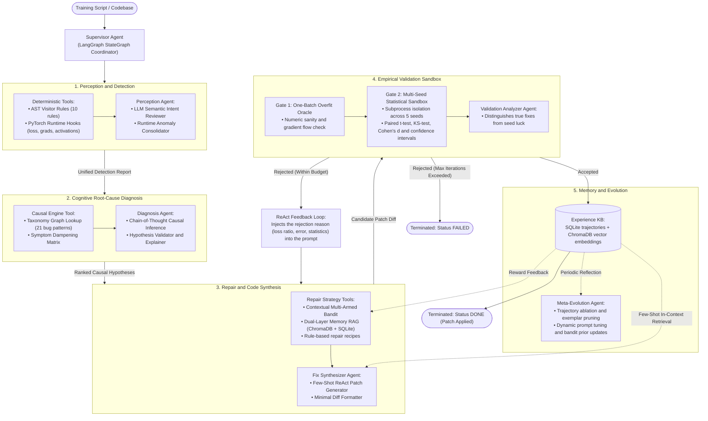

# Deep Learning Debugger (`silent-bug-agent`)

An autonomous multi-agent system that **detects, diagnoses, and fixes silent bugs in deep learning training**: the kind where the code runs without errors, the loss even goes down, and the model still doesn't learn what you think it does.

---

## Why This Exists

Crashes are easy: you get a traceback. Silent bugs are not. Examples:

* `model.eval()` never called before validation, so BatchNorm and Dropout keep behaving as in training
* A layer that is trainable but was left out of the optimizer, so it never updates
* `optimizer.zero_grad()` missing, so gradients accumulate across batches
* Softmax applied before `CrossEntropyLoss` (which internally applies LogSoftmax)
* Features and labels shuffled independently
* Missing input normalization, or a learning rate that is far too high
* Dead ReLUs silently killing gradient propagation

Nothing raises an exception. You just get a worse model and hours of wasted compute. This project automates the entire detection, diagnosis, repair, and empirical validation pipeline.

---

| Agent | What it does |
|---|---|
| **Supervisor** | LangGraph StateGraph orchestrator, state transitions & lifecycle |
| **0** | Bug taxonomy (21 seed patterns) + runtime invariant library |
| **1** | PyTorch hooks, live runtime monitor agent, profiling & alerts |
| **2** | AST static analyzer + LLM semantic reviewer + unified CLI |
| **3** | One-batch-overfit oracle + multi-seed statistical validation sandbox |
| **4** | Root-cause diagnosis & causal dampening graph + LLM reasoning |
| **5** | Fix synthesizer agent (MAB bandit + ReAct LLM patch generation) |
| **6** | Experience memory (knowledge base store + contextual bandit routing) |
| **7** | Meta-evolution self-reflective agent (prompt tuning & exemplar pruning) |

---

## Multi-Agent Architecture

The system is built as a **cooperative multi-agent ecosystem** orchestrated by a central **LangGraph StateGraph** (`silent_bug_agent/agents/supervisor.py`). Every stage operates as a **Hybrid Node**: deterministic tools (AST analysis, PyTorch telemetry hooks, causal inference, sandboxed execution) combined with LLM agents for semantic perception, causal reasoning, code synthesis and verdict analysis.



### Hybrid Node Workflow

Each stage in the LangGraph execution flow follows a two-phase execution:
1. **Deterministic Phase (Sensory and Metric Tools)**: high-speed tools run directly on code and tensors to collect ground truth (AST violation lines, gradient norms, causal dampening weights, loss curves from real runs).
2. **Cognitive Phase (LLM Agents)**: LLM prompts (Groq `openai/gpt-oss-120b` and `openai/gpt-oss-20b`, with Cerebras `gpt-oss-120b` and `qwen-3.8-27b` as backup) read the tool outputs, reason about cause and effect, and return strict-JSON decisions to the LangGraph state.

The full model list for each agent is in [docs/models_and_apis.md](docs/models_and_apis.md).

### Key Architectural Principles:
- **Statistical, Not Formal**: Training is stochastic. Correctness is measured with paired t-tests, Kolmogorov-Smirnov tests, Cohen's $d$, confidence intervals and loss ratios across multiple seeds.
- **Hierarchical Validation Gates**: Patches must pass a cheap numeric filter (Gate 1: one-batch overfit on the real script) before the expensive multi-seed sandbox (Gate 2).
- **Do No Harm**: A patch is accepted only if it improves results significantly, or removes a detected warning-level bug without making results worse. An informational hint must prove itself with statistics. The LLM can veto an acceptance but can never overrule a rejection.
- **ReAct Feedback-Driven Repair**: If a candidate fails a gate, the exact reason (exception, loss ratio, p-value) is fed into the Fix Synthesizer's next prompt.
- **Dual Memory & Self-Evolution**: Successful repairs are embedded in ChromaDB for retrieval in future repairs. The Meta-Evolution agent prunes examples that make results worse and rolls back prompt lessons that lower the success rate.
- **Zero-Key Fallbacks**: Runs live with free `GROQ_API_KEY` / `CEREBRAS_API_KEY` keys, or fully without keys using rule-based repair recipes. The run report always states which models were used, or that none were.
- **No GPU needed**: everything runs on a CPU, including validation.

---

## Quick Start

Requires Python 3.10 or newer (3.12 recommended). Works on Windows, Linux and macOS.

```bash
# 1. Get the code
git clone https://github.com/shreyasshah707/AgenticDLDebugger.git
cd AgenticDLDebugger

# 2. Setup virtual environment
python -m venv .venv
# Linux/macOS:
source .venv/bin/activate
# Windows:
.venv\Scripts\activate

# 3. Install dependencies
pip install -e ".[torch,semantic,dev]"

# 4. Check the installation, keys and models
python -m silent_bug_agent doctor
```

[SETUP.md](SETUP.md) has the longer walkthrough, including the optional terminal UI (needs Node.js).

---

## LLM API Keys & Environment Setup

The system works without keys, using rule-based recipes and statistics. Add a free key to turn on the LLM agents.

Copy `.env.example` to `.env`:
```bash
cp .env.example .env          # Windows: copy .env.example .env
```

Edit `.env`:

```dotenv
# --- Groq (main provider, free tier): https://console.groq.com/keys ---
GROQ_API_KEY=paste_your_groq_key_here

# --- Cerebras (backup provider, free tier): https://cloud.cerebras.ai ---
CEREBRAS_API_KEY=paste_your_cerebras_key_here
```

> **Priority**: each agent tries **Groq** $\rightarrow$ **Cerebras** $\rightarrow$ **offline rules**. When Groq's free limit is reached, the same request goes to Cerebras.

Then confirm both keys answer:
```bash
python -m silent_bug_agent doctor --live
```

---

## CLI Usage

The CLI has four core commands (`scan`, `monitor`, `diagnose`, `fix`), plus `apply`, `wsp`, `doctor` and `ui`. Arguments for your own script go after `--`.

> **The bundled examples are protected.** The tests and the results below depend on the bugs planted in `examples/`, so `fix` and `apply` never edit those files: they show the validated patch and stop. To see a fix applied, work on a copy:
> ```bash
> cp examples/sample_scripts/buggy_mnist.py my_train.py      # Windows: copy examples\sample_scripts\buggy_mnist.py my_train.py
> ```

### 1. Static & Semantic Code Scan (`scan`)
```bash
# Static AST scan
python -m silent_bug_agent scan examples/sample_scripts/buggy_mnist.py

# Static + LLM Semantic Review (uses GROQ_API_KEY or CEREBRAS_API_KEY from .env)
python -m silent_bug_agent scan examples/sample_scripts/buggy_mnist.py --semantic

# Output machine-readable JSON for CI/CD
python -m silent_bug_agent scan examples/sample_scripts/buggy_mnist.py --json
```

### 2. Live Runtime Monitoring (`monitor`)
Runs a training script under PyTorch inspection hooks to catch gradient explosions, loss divergence, frozen layers and more:
```bash
python -m silent_bug_agent monitor examples/sample_scripts/benchmark_01_missing_zero_grad.py
```

### 3. Root-Cause Diagnosis (`diagnose`)
Runs detection and ranks root-cause hypotheses with confidence scores:
```bash
python -m silent_bug_agent diagnose examples/sample_scripts/buggy_mnist.py
```

### 4. Autonomous Repair Pipeline (`fix`, then `apply`)
Runs the full supervisor loop: detection $\rightarrow$ diagnosis $\rightarrow$ patch synthesis $\rightarrow$ validation. There are two ways to use it:

```bash
# Review first (recommended): validate a patch, show it, change nothing
python -m silent_bug_agent fix my_train.py --dry-run
# ...then write exactly the patch that was validated and shown
python -m silent_bug_agent apply my_train.py

# Or in one step: validate and write, for up to --max-rounds (3) bugs
python -m silent_bug_agent fix my_train.py --max-iter 3
```

Whenever a file is written, the original is kept beside it as `<name>.py.orig`. `apply` refuses if the script changed after the patch was validated.

A `fix` run fixes one bug per round, re-detecting each time; `--dry-run` stops after the first. On a CPU each round takes about 1 to 2 minutes for the sample scripts, mostly spent on the 10 training runs of Gate 2.

### 5. Weight inspection (`wsp`, read-only)
Looks at a model's numbers for signs of a training bug that the code does not show: NaN or exploded values, a weight matrix stuck at zero, biases so negative that a ReLU cannot fire, and collapsed rank. It only reads. It never changes a script or a checkpoint; a repair belongs in the code, where `fix` can test it.

```bash
# Train the script for 60 steps in the sandbox, then inspect the weights it produced
python -m silent_bug_agent wsp examples/sample_scripts/benchmark_06_dead_relu.py

# Or inspect a saved state_dict (loaded with weights_only=True, so a pickle cannot run code)
python -m silent_bug_agent wsp --checkpoint model.pt --json
```

### 6. Installation check (`doctor`)
```bash
python -m silent_bug_agent doctor          # libraries, .env, keys, model per task
python -m silent_bug_agent doctor --live   # also sends one tiny request to each model
```

### 7. Terminal UI (`ui`, optional)
A keyboard-driven front end over the same commands, built with Ink. It needs Node.js 18 or newer:
```bash
cd tui && npm ci && npm run build && cd ..
python -m silent_bug_agent ui
```
Its Fix screen always validates first and asks before writing; choosing "Apply" runs the `apply` command above.

---

## Results

`python examples/evaluate_pipeline.py --offline` runs all 8 benchmarks twice through the full pipeline on private copies: once buggy, and once healthy (with `--fix`), to measure the damage rate too.

Measured on 3 November 2026, offline (no LLM key), CPU only, 5 seeds per arm:

| Benchmark | Planted bug | Fixed | Bug the accepted patch fixed | p-value | Healthy twin |
|---|---|---|---|---|---|
| 01 | missing `zero_grad()` | yes | missing_zero_grad | 0.005 | left alone |
| 02 | `model.eval()` missing | yes | train_eval_mode_mismatch | 0.0003 | left alone |
| 03 | layer left out of the optimizer | yes | frozen_layer_no_grad | 0.0002 | left alone |
| 04 | softmax before CrossEntropyLoss | yes | softmax_before_cross_entropy | 0.0003 | edited (see below) |
| 05 | learning rate 50 | yes | learning_rate_misconfigured | < 0.0001 | left alone |
| 06 | dead ReLUs from bias −100 | yes | dead_relu | < 0.0001 | left alone |
| 07 | `reduction="sum"` | yes | learning_rate_misconfigured (symptom) | 0.087 | left alone |
| 08 | unnormalised inputs | yes | non_normalized_inputs | 0.001 | left alone |

- **Repaired:** 8 of 8. **Right cause ranked first:** 8 of 8. **Accepted patch fixed the planted bug itself:** 7 of 8.
- **Benchmark 07:** the real fix (`reduction="mean"`) was tried first and rejected, because on this benchmark it gave no significant gain (p = 0.088). The accepted patch lowers the learning rate instead, which offsets the summed loss. It passed because the critical learning-rate finding disappeared and results did not get worse.
- **Healthy twin of 04:** the softmax line is still in the file but only runs without `--fix`. The patch removed it, which changes nothing when the script runs with `--fix`, so no healthy behaviour was damaged.
- **`buggy_mnist.py` (three bugs):** round 1 fixed softmax-before-CrossEntropyLoss (p < 0.0001). The missing `zero_grad()` fix was then rejected: on this script, accumulating gradients makes training *faster* over the first 200 steps (loss ratio 0.21 to 0.40 buggy, against 0.50 to 0.65 fixed), so a statistical gate on training loss cannot show the fix is better.
- Each buggy benchmark takes about 70 to 80 seconds on an Apple M2 CPU; a healthy one about 5 seconds.
- The LLM agents were tested against a local fake provider. Their live repair rate has not been measured yet.

---

## Repository Structure

```
AgenticDLDebugger/
├── .env.example                      # Template for Groq/Cerebras keys
├── pyproject.toml                    # Package metadata & entrypoints
├── SETUP.md                          # Step-by-step installation, including the terminal UI
├── .github/workflows/tests.yml       # CI: the test suite on Linux and Windows, and the TUI build
├── docs/
│   ├── models_and_apis.md            # Model per agent, providers, free limits
│   ├── module1_runtime_hooks.md      # Module 1 hooks design
│   ├── runtime_monitor_agent.md      # Module 1 agent design
│   ├── overhead_benchmark.md         # Module 1 overhead benchmark
│   └── ARCHITECTURE.md, THREAT.md…   # Design notes: architecture, flow, threats, failure modes, decisions
├── tui/                              # Optional terminal UI (TypeScript, Ink + Pastel)
├── silent_bug_agent/                 # Core package
│   ├── cli.py                        # Unified CLI (scan, monitor, diagnose, fix, apply, wsp, doctor, ui)
│   ├── events.py                     # NDJSON events the terminal UI reads (--events)
│   ├── config.py                     # .env loading, memory folder
│   ├── findings.py                   # Standardized Finding and Report schemas
│   ├── schemas.py                    # Multi-agent state machine contracts
│   ├── supervisor.py                 # Validation pipeline coordinator
│   ├── invariants/                   # Module 0: Invariant check library
│   ├── taxonomy/                     # Module 0: Silent bug YAML taxonomy
│   ├── runtime/                      # Module 1: PyTorch hooks, profiling, session
│   ├── static/                       # Module 2: 10 AST-based static bug rules
│   ├── semantic/                     # Module 2: LLM reviewer, Groq/Cerebras client, model router
│   ├── validation/                   # Module 3: Overfit oracle, multiseed sandbox, script runner, analyzer
│   ├── diagnosis/                    # Module 4: causal engine, taxonomy graph, bridge to the bug list
│   ├── repair/                       # Module 5: Patch application, AST repair recipes, pending patches for `apply`
│   ├── wsp/                          # Read-only weight inspector
│   ├── learning/                     # Module 6: ChromaDB experience store & bandit
│   └── agents/                       # Autonomous agent nodes:
│       ├── supervisor.py             # Central orchestrator state machine (LangGraph)
│       ├── runtime_monitor_agent.py  # Module 1 live inspection agent
│       ├── diagnosis_agent.py        # Module 4 causal ranking agent
│       ├── fix_synthesizer_agent.py  # Module 5 patch generation agent
│       ├── meta_evolution.py         # Module 7 self-reflection agent
│       └── prompts.py                # Prompts and strict JSON schemas
├── examples/
│   ├── sample_scripts/
│   │   ├── buggy_mnist.py            # Three bugs; downloads MNIST, or uses random digits offline
│   │   ├── clean_mnist.py            # Reference clean script
│   │   ├── benchmark_01_missing_zero_grad.py
│   │   ├── benchmark_02_train_eval_mode.py
│   │   ├── benchmark_03_frozen_layer.py
│   │   ├── benchmark_04_softmax_before_crossentropy.py
│   │   ├── benchmark_05_learning_rate_too_high.py
│   │   ├── benchmark_06_dead_relu.py
│   │   ├── benchmark_07_wrong_loss_reduction.py
│   │   └── benchmark_08_unnormalized_inputs.py
│   ├── benchmark_hooks.py            # Module 1 overhead benchmark
│   └── evaluate_pipeline.py          # Repair rate and damage rate on the benchmarks
└── tests/                            # 426 automated tests (pytest)
```

---

## Running the Test Suite

The tests never call a real API: LLM behaviour is tested against a local fake server that speaks the same protocol.

```bash
python -m pytest tests/ -v
```

To run targeted test suites:
```bash
# LLM client, model router and fallback between providers
python -m pytest tests/test_llm_client.py -v

# MetaEvolutionAgent and experience memory
python -m pytest tests/test_memory_and_meta.py -v

# MultiSeed & Sandbox Validation
python -m pytest tests/test_multiseed_agent.py -v

# Runtime Monitor (Module 1)
python -m pytest tests/test_runtime_monitor_agent.py -v

# Full pipeline, offline and with a fake LLM provider (slow: real training runs)
python -m pytest tests/test_supervisor_pipeline.py -v
```

---

## Known Limits

- Benchmarks are small synthetic scripts. Repair and damage rates on real projects have not been measured.
- Gate 2 compares training loss (or the `final_loss` a script prints as `__METRICS__:{...}`). A bug that speeds up early training, like a missing `zero_grad()` on `buggy_mnist.py`, cannot be confirmed that way. Print a validation metric as `__METRICS__` to judge such fixes properly.
- The Windows-specific paths (memory limits through Job Objects) are written but not covered by a test. CI runs the suite on Windows and Linux; nobody has run it on Python 3.14 yet (3.10 to 3.12 are tested).
- `wsp` finds what is visible in the numbers after a short run: it will not see a bug that leaves the weights looking ordinary. Matrices larger than 1024 on a side are not checked for rank.
- The terminal UI has no automated tests. Its build is checked in CI, and the event stream it reads is tested from Python.
- The LLM path has been tested against a fake provider. Run `doctor --live` once real keys are in `.env`.
- Dead units are measured only for `nn.ReLU` modules. A model that calls `F.relu` is not checked for dead units.
- A script that needs its own command-line arguments must be given them after `--`.

---

## License

MIT License. See [LICENSE](LICENSE) for details.
