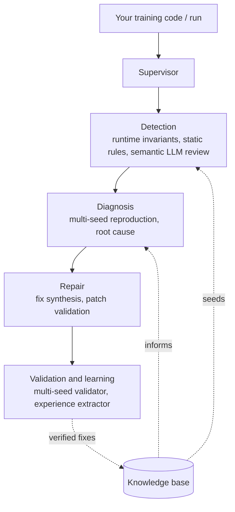

# Deep Learning debugger

An open-source agent that **detects, diagnoses and fixes silent bugs in deep
learning training**: the kind where the code runs without errors, the loss even
goes down, and the model still doesn't learn what you think it does.

> **Status: active development.** The foundation (bug taxonomy + runtime
> invariants) is built and tested, the PyTorch adapter bench verified on real
> PyTorch, and Phase 2 (AST static analyzer + semantic LLM reviewer + CLI) is
> implemented with **55/55 tests passing**. See [Project status](#project-status).

## Why this exists

Crashes are easy: you get a traceback. Silent bugs are not. Examples:

* `model.eval()` never called before validation, so BatchNorm and Dropout keep
  behaving as in training
* a layer that is trainable but was left out of the optimizer, so it never updates
* `optimizer.zero_grad()` missing, so gradients accumulate across batches
* softmax applied before `CrossEntropyLoss` (which internally applies LogSoftmax)
* features and labels shuffled independently
* missing input normalization, or a learning rate that is far too high

Nothing raises. You just get a worse model and a long debugging session. This
project aims to automate that session.

## Project status

| Phase | What it is | Status |
|---|---|---|
| 0 | Bug taxonomy + runtime invariant library | **Built, 13/13 tests passing** |
| – | PyTorch adapter + test bench (`examples/`) | **Verified on real PyTorch (6/6 detected/passed)** |
| 1 | PyTorch hooks, live runtime monitor | Planned (the adapter is a working prototype) |
| 2 | Static analyzer (AST) + semantic (LLM) analyzer + CLI | **Built, 55/55 tests passing across Phases 0 & 2** |
| 3 | One-batch-overfit and multi-seed validation | Planned |
| 4 | Root-cause diagnosis | Planned |
| 5 | Fix synthesis and patch validation | Planned |
| 6 | Learning loop (experience → knowledge base) | Planned |
| 7 | Meta-evolution of prompts/workflows | Planned (research track) |

## Architecture



Design principles:

* **Statistical, not formal.** Training is stochastic: loss does not decrease
  monotonically even in a correct run. So correctness is checked with tolerances,
  rolling windows and hypothesis tests, not proofs. An earlier design used
  Lean4/Coq specs and an SMT-based patch verifier; both were dropped because
  they don't fit the problem.
* **Empirical validation.** A fix counts as verified only if it passes real runs
  (one-batch overfit, then multiple seeds compared as distributions), never a
  single run.
* **Small knowledge base that grows.** It starts from the hand-written taxonomy
  and grows from fixes the tool actually verifies. No large pre-existing dataset
  is assumed.
* **Framework-agnostic core.** The invariants operate on a plain `TrainingState`
  snapshot and never import torch. PyTorch is one adapter on top.

## Quick start

Requires Python 3.9+.

```bash
git clone https://github.com/silent-bug-agent/silent-bug-agent.git
cd silent-bug-agent
python -m venv .venv && source .venv/bin/activate   # Windows: .venv\Scripts\activate
pip install -r requirements.txt
pip install -e .

# Run the test suite
python -m pytest tests/ -v
```

### Static code scanning with the CLI

Scan any training script or repository for silent bugs using AST-based static rules:

```bash
# Scan a script (text report)
python -m silent_bug_agent scan examples/sample_scripts/buggy_mnist.py

# Or if installed via pip:
silent-bug-agent scan examples/sample_scripts/buggy_mnist.py

# Export structured JSON findings for CI
silent-bug-agent scan examples/sample_scripts/buggy_mnist.py --json

# Run semantic LLM review in addition to static analysis (requires ANTHROPIC_API_KEY)
silent-bug-agent scan examples/sample_scripts/buggy_mnist.py --semantic
```

### Try runtime invariants on a real PyTorch model

`torch` and `torchvision` are in `requirements.txt`.

```bash
# Run the synthetic invariant demo (no torch required)
python examples/demo_invariant_check.py

# Run the test bench across planted bugs (eval_mode, frozen, high_lr, dead_relu, random_labels)
python examples/planted_bugs_torch.py --bug all
```

### Test your own training script

Open `examples/planted_bugs_torch.py` and paste your script into the
**CUSTOM CODE SECTION** near the top (no indentation needed). Keep or add two
lines, `collector = TorchStateCollector(model)` after the model is built and
`check(collector, loss)` right after `optimizer.step()`. Then run:

```bash
python examples/planted_bugs_torch.py --bug custom
```

## Phase 0 in detail

**Taxonomy** (`silent_bug_agent/taxonomy/bug_taxonomy.yaml`): 21 seed bug
patterns, each with symptoms, a category, whether it is detectable statically /
at runtime / semantically, a typical fix, and links to the invariants that can
catch it. Categories draw on published empirical studies of real DL bugs
(Islam et al. 2019; Humbatova et al. 2020) plus common training-debugging
practice.

**Invariants** (`silent_bug_agent/invariants/`): five checks over a `TrainingState`:

| Invariant id | Catches |
|---|---|
| `gradient_norm_bounds` | exploding or vanishing gradients, NaN gradients |
| `frozen_weights` | a trainable parameter that stops changing |
| `train_eval_mode_mismatch` | BatchNorm/Dropout in the wrong mode for the phase |
| `activation_health` | NaN/Inf activations, mostly-dead units |
| `loss_trend` | loss not improving over a window (deliberately *not* a monotonic check) |

Check how much of the taxonomy is covered:

```python
from silent_bug_agent.taxonomy import load_taxonomy, coverage_report
print(coverage_report(load_taxonomy()))
```

## Phase 2 in detail

Phase 2 adds code-level detectors that catch silent bugs before or alongside training:

1. **AST Static Analyzer** (`silent_bug_agent/static/`):
   - Zero-dependency Python stdlib `ast` analyzer.
   - 10 targeted rules matching taxonomy entries:
     - `missing_zero_grad`
     - `lr_scheduler_step_order_bug`
     - `unset_random_seed`
     - `optimizer_state_leak_across_folds`
     - `silent_device_fallback`
     - `duplicate_augmentation_applied_twice`
     - `gradient_accumulation_miscount`
     - `wrong_loss_reduction`
     - `non_normalized_inputs`
     - `softmax_before_cross_entropy`
2. **Semantic LLM Reviewer** (`silent_bug_agent/semantic/`):
   - Pluggable `LLMClient` (with `FakeLLMClient` for testing and `AnthropicClient` for live reviews).
   - Dynamic prompt generation restricted to taxonomy bugs with `semantic_detectable: true`.
   - Prompt-injection defenses (untrusted code isolation).
   - Evidence grounding verification (downgrades confidence if quoted snippet cannot be anchored near the reported line).
3. **Unified Findings & CLI** (`findings.py`, `cli.py`):
   - Common `Finding` and `Report` schema with deduplication (`merge_reports`).
   - CLI with text and JSON outputs for local use and CI/CD pipelines.

## Repository layout

```
silent-bug-agent/
├── README.md
├── LICENSE                           # MIT License
├── pyproject.toml                    # Package metadata & CLI entrypoint
├── requirements.txt
├── .gitignore
├── silent_bug_agent/                 # the package
│   ├── __init__.py
│   ├── findings.py                   # shared bug-report format
│   ├── cli.py                        # scan entry point
│   ├── invariants/                   # Phase 0: runtime invariant checks
│   │   ├── __init__.py
│   │   ├── base.py                   #   TrainingState, Invariant, Severity
│   │   ├── gradient.py
│   │   ├── weights.py
│   │   ├── mode.py
│   │   ├── activation.py
│   │   ├── loss.py
│   │   └── registry.py
│   ├── taxonomy/                     # Phase 0: known silent-bug catalogue
│   │   ├── __init__.py
│   │   ├── bug_taxonomy.yaml
│   │   └── loader.py
│   ├── static/                       # Phase 2: AST-based rules
│   │   ├── __init__.py
│   │   ├── base.py
│   │   ├── rules.py
│   │   └── analyzer.py
│   ├── semantic/                     # Phase 2: LLM reviewer
│   │   ├── __init__.py
│   │   ├── client.py
│   │   ├── prompt.py
│   │   └── analyzer.py
│   ├── runtime/                      # (planned) Phase 1: PyTorch hooks
│   ├── validation/                   # (planned) Phase 3: overfit + multi-seed
│   ├── diagnosis/                    # (planned) Phase 4: root cause
│   ├── repair/                       # (planned) Phase 5: fix synthesis
│   ├── learning/                     # (planned) Phase 6: experience extraction
│   └── meta/                         # (planned) Phase 7: meta-evolution
├── examples/
│   ├── demo_invariant_check.py       # synthetic scenarios, no torch
│   ├── torch_adapter.py              # stopgap TrainingState collector for torch
│   ├── planted_bugs_torch.py         # test bench + CUSTOM CODE section
│   └── sample_scripts/               # buggy and clean scripts for testing
│       ├── buggy_mnist.py
│       └── clean_mnist.py
└── tests/
    ├── test_invariants.py
    ├── test_findings.py
    ├── test_static.py
    ├── test_semantic.py
    └── test_cli.py
```

## Roadmap

1. **Phase 1, live runtime monitor.** Proper PyTorch hooks populate `TrainingState` every step; violations become alerts with a reproducible trace.
2. **Phase 2, static + semantic detectors.** *(Completed)* AST-based analyzer and LLM reviewer with CLI.
3. **Phase 3, validation oracle.** One-batch-overfit test and multi-seed reproduction, comparing metric distributions rather than single runs.
4. **Phase 4, root-cause diagnosis.** A small knowledge graph seeded from the taxonomy; statistical specs checked against Phase 3 runs.
5. **Phase 5, repair.** LLM + retrieval fix synthesis; every candidate patch is validated with Phase 3 runs.
6. **Phase 6, learning loop.** Verified repairs are logged into the knowledge base; a contextual bandit picks which repair strategy to try first.
7. **Phase 7, meta-evolution** (research track). Automated prompt and workflow search, only once there is real outcome data.

## License

MIT License. See [LICENSE](LICENSE) for details.
