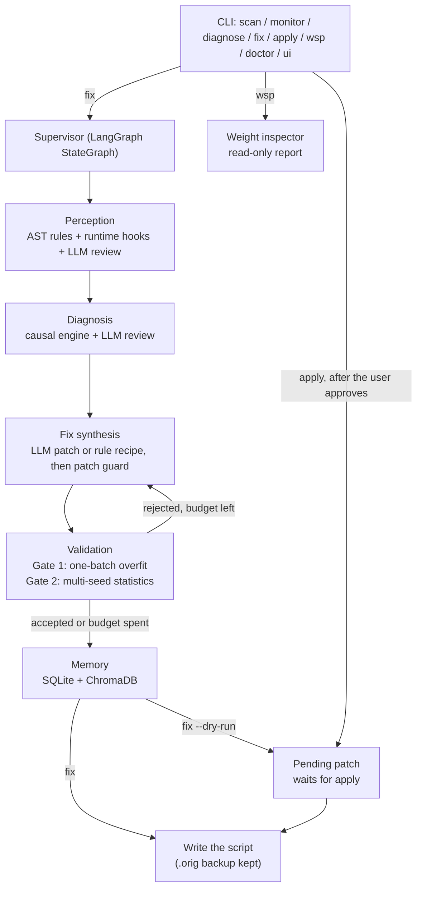

# Architecture Overview

> See also: [DATA.md](DATA.md) · [THREAT.md](THREAT.md) · [FLOW.md](FLOW.md) · [FAILURE.md](FAILURE.md)

## Modules & Responsibilities

| Module | Owns | Does NOT touch |
|---|---|---|
| `cli.py` | CLI entry point, argument parsing, session bootstrap | Agent internals |
| `agents/supervisor.py` | LangGraph StateGraph orchestration, node routing, retry budget | Individual agent logic |
| `runtime/` | PyTorch hooks, live telemetry, profiling, session management | Static analysis |
| `static/` | AST-based rule engine (10 rules), bug detection without execution | Runtime state |
| `semantic/` | LLM client, model router (Groq/Cerebras), semantic review | Deterministic rules |
| `invariants/` | Invariant check library (gradient, activation, loss, weight, mode) | Storage |
| `taxonomy/` | YAML bug taxonomy loader, 21 seed bug patterns | Inference |
| `diagnosis/` | Causal engine, symptom dampening graph, DiagnosisAgent | Patch generation |
| `repair/` | Patch application, patch guard, AST recipes, the repair loop, pending patches for `apply` | Validation |
| `validation/` | Overfit oracle (Gate 1), multi-seed sandbox (Gate 2), ValidationAnalyzerAgent | Patch creation |
| `learning/` | ChromaDB vector store, SQLite trajectory DB, contextual bandit | Agent orchestration |
| `agents/meta_evolution.py` | Trajectory ablation, exemplar pruning, prompt tuning, bandit prior updates | Real-time decisions |
| `wsp/` | Read-only weight inspection: non-finite and exploded values, zeroed matrices, collapsed biases and rank | Any write to a script, model or checkpoint |
| `events.py` | NDJSON events (`--events`) that the terminal UI renders | Agent logic |
| `tui/` (TypeScript) | Optional Ink terminal UI; runs the CLI commands as subprocesses | Any pipeline logic of its own |

## Trust Boundaries & Data Entry

- **Untrusted Input Points:**
  - `cli.py` — target script path, checkpoint path, and CLI flags from the user
  - `wsp/inspector.py` — checkpoint files from the user's disk, loaded only with `weights_only=True` or `safetensors`
  - `validation/script_runner.py` and `agents/runtime_monitor_agent.py` — execute the user's script, and LLM-written patches to it, in a subprocess. This isolates crashes and hangs; it is not a security sandbox (see THREAT.md)
  - `semantic/client.py` — receives LLM-generated JSON (untrusted structured output)
  - `runtime/hooks.py` — tensor data from user model hooks (numeric validation required)

- **Internal Boundaries:**
  - CLI/User → `AgentState` (typed, validated dataclass) → all agents
  - LLM responses → JSON schema validation (strict parse in `agents/prompts.py`) → `DiagnosticHypothesis` / `PatchCandidate`
  - Subprocess stdout → `__METRICS__:{...}` protocol parse → `ValidationVerdict`

## System Map

The weight inspector is separate from the repair pipeline: it reports and never feeds a patch.

## Key Design Principles

1. **Hybrid Nodes** — every agent pairs deterministic tools with an LLM for perception/reasoning
2. **Single State Contract** — `AgentState` dataclass flows through every node; no raw dicts between agents
3. **Empirical Gate** — the script is written only after a patch passes Gate 1 and then either Gate 2's statistics or the "bug gone and not worse" rule
4. **Approval Is Real** — with `--dry-run` nothing is written; `apply` writes only the validated patch; bundled examples are never edited
5. **Test Isolation** — `SBA_NO_DOTENV=1` + fake LLM server; no real API call in any test
