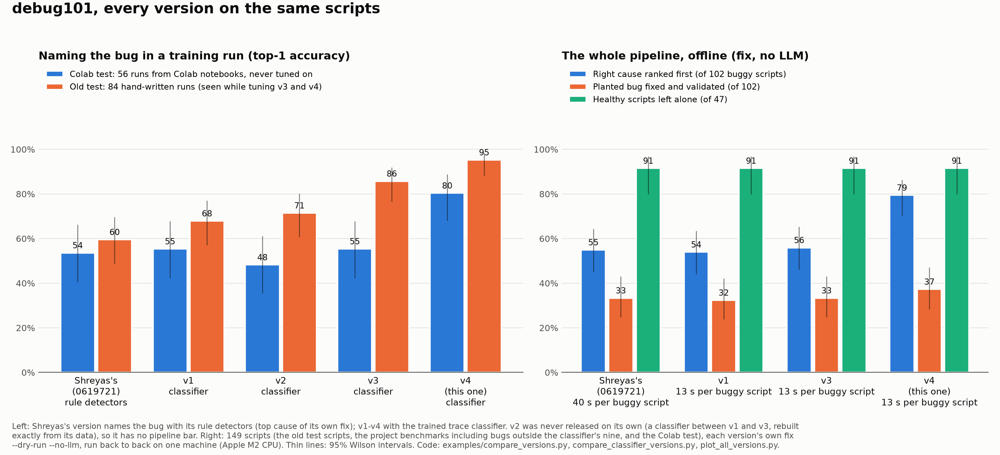
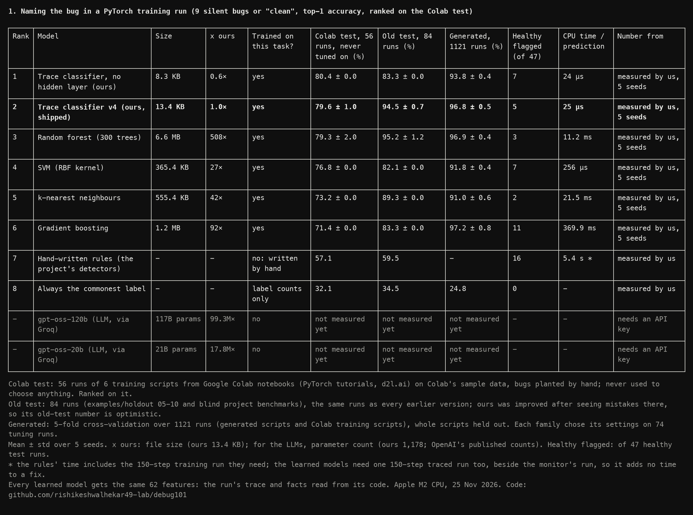
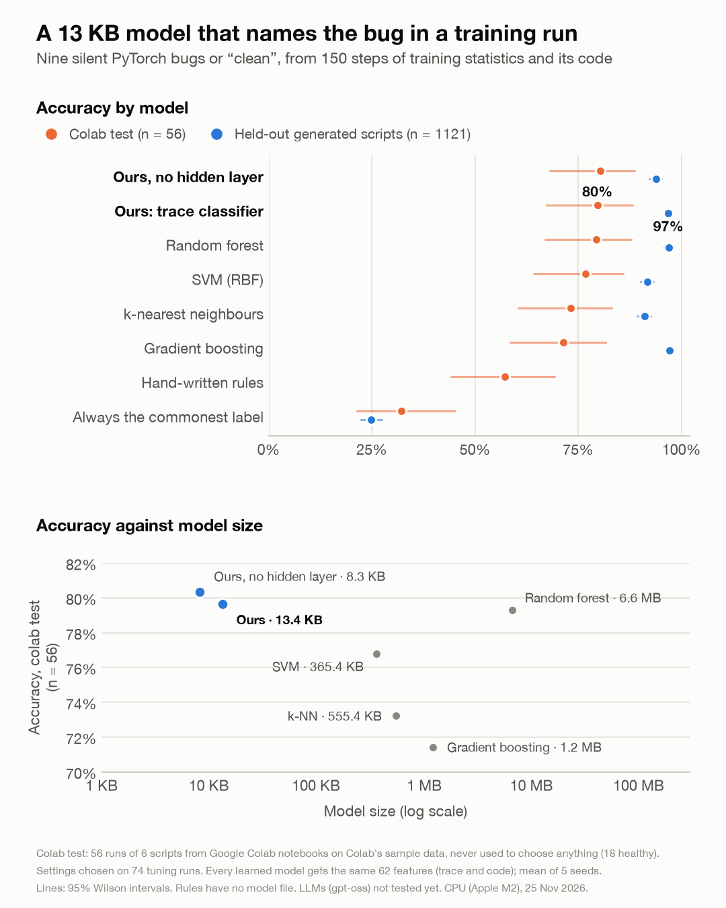

# The trace classifier: a small trained model for diagnosis

The pipeline's LLMs are not what makes a run slow: offline, validation takes most of the
time (see `Time:` at the end of every `fix` run). So the trained model does not replace
them. It does the job a small model is good at: recognising, from the numbers a training
run produces and a few facts about its code, which known bug the run looks like.

Version 4 has 62 inputs and one tanh hidden layer of 16 units, 1,178 weights in all. It
ships as a 16.5 KB file inside the package (13.4 KB is the model; the rest records how it
was trained) and needs no key and no network. One prediction takes about 17 µs on a laptop
CPU. The script is traced for 150 steps, as long as the
runtime monitor's own run, and the trace runs alongside it, so it adds no time to a `fix`.





## What it reads

`script_runner --trace` (`silent_bug_agent/learned/trace.py`) records numbers only,
never tensors. `learned/features.py` turns them into scale-free features (ratios,
fractions and logs), and `learned/code.py` adds facts read from the script's syntax tree.

| Signal | Points to |
|---|---|
| gradient norm per step, and its growth | missing `zero_grad()` (gradients pile up) |
| **v4:** whether the weights a backward pass reaches still hold a gradient from before an update | missing `zero_grad()`, however the script clears gradients (`zero_grad()`, `p.grad = None`, `p.grad.zero_()`); deliberate gradient accumulation does not count |
| share of parameters without a gradient, how far each step moved the weights, tensors that never moved | frozen layer, dead units, learning rate |
| share of the model's trainable parameters that no optimizer updates | a layer left out of the optimizer |
| learning rate; **v4:** the step actually taken compared with the gradient, and the optimizer's kind | learning rate, also in scripts that update weights by hand |
| model outputs inside [0, 1] whose rows sum to 1; `cross_entropy` given probabilities | softmax before the loss |
| share of ReLU outputs that are zero; **v4:** tanh/sigmoid saturation, first-to-last layer gradient ratio | dead ReLUs, vanishing gradients |
| scale of the inputs | inputs not normalised |
| validation passes in training mode, counted only when the model has dropout or batch norm | `model.eval()` missing |
| every loss-function call (reduction, the loss of guessing, validation loss, trend) and, **v4**, the loss curve at a quarter, half and three quarters of the run | `reduction="sum"`, shuffled labels, slow but healthy runs |
| **v4, from the code:** gradient clearing in the loop that calls `backward()`, `eval()` calls, softmax and cross-entropy together, `reduction="sum"`, `.sum().backward()`, `requires_grad=False`, an optimizer given part of a model, input scaling, labels permuted on their own, the learning rate written in the code | the same bugs, from what the script says rather than what it did |

Scripts that update their weights by hand, with no optimizer, were invisible to versions
1 to 3, because the tracer hooked `optimizer.step()`. Version 4 also watches every
`backward()` call. The runner now stops such scripts after the step budget of backward
passes, as it already did for optimizer steps.

## The data

There is no public dataset of buggy training runs, so the data is built:

- **Training: generated scripts** (`silent_bug_agent/mutation/`). 120 healthy scripts that
  vary everything that changes a trace. Version 4 adds:
  - raw weight tensors updated by hand;
  - GRU sequence models;
  - training and evaluation in functions;
  - a learning-rate scheduler;
  - gradient clipping;
  - gradient accumulation over two batches;
  - a summed loss paired with a learning rate divided by the batch size, a healthy pattern for SGD.

  The mutation operators plant one bug at a time. Version 4 adds new ways to plant them:
  clearing removed from hand-written updates, a learning rate 10,000 times too small, the
  `/ 255` left out, and labels shuffled, shifted by one or resampled.
- **Training: Colab notebooks** (`examples/colab/`). Seven scripts that follow Google Colab
  notebooks (the PyTorch tutorials and d2l.ai) on Colab's own sample data, MNIST and
  California housing. The operators plant their bugs, and each version is traced with three seeds.
- **Label check (new in v4).** A planted bug must make the run worse than the healthy version
  of the same script with the same seed, or it is left out: a "bug" that changes nothing is
  a wrong label. Two exceptions:
  - A missing `eval()` only shows in validation.
  - A summed loss is defined by the code (Adam hides its effect, and the project's test sets
    count it as a bug).

  The check left out 106 generated and 34 Colab buggy versions.
- **Tuning**, on which settings are chosen and only whose mistakes are studied:
  `examples/holdout/` 01 to 04 (39 runs) and four Colab scripts (35 runs).
- **Test**, never used to choose anything:
  - **Colab test** (new): six Colab-notebook scripts with bugs planted by hand, 56 runs, 18
    of them healthy. Five planted bugs failed the label check on a 300-step run and are not
    in it (see `examples/colab/README.md`).
  - **Old test**: `examples/holdout/` 05 to 10 and blind copies of the project's benchmarks,
    84 runs, 29 of them healthy. These are the same runs every earlier version was scored on.

1,121 training runs, 278 of them healthy.

```bash
python examples/colab/fetch_sample_data.py                     # Colab's sample_data, once
python -m silent_bug_agent.mutation.dataset --templates 120 --max-steps 150 --out traces.jsonl
python -m silent_bug_agent.learned.train --data traces.jsonl
```

## The model

`train.py` tries a softmax regression and networks with one tanh hidden layer of 16 or 32
units, each with two strengths of L2 regularisation, and each with and without extra training
copies whose code features are hidden. It keeps the settings with the best accuracy on the
tuning scripts, averaged over three seeds; on a tie, the simpler model wins. One hidden layer
of 16 units, with the hidden-code copies, won (87.4% on the tuning scripts).

The temperature that makes its probabilities honest on the tuning scripts (1.2) is stored
with the weights, so "p = 0.8" means about 8 in 10. A top guess below 0.5 is shown as
"unsure". The model is numpy only (`learned/model.py`), and the weights are plain JSON.

## Against other models

Every model gets the same 62 features and chooses its settings on the same tuning scripts,
from a small grid each. Each learned model is retrained with 5 seeds and the scores are the
mean. The shipped row uses exactly the settings `train.py` chose.
`examples/compare_models.py` produces all of it, and `plot_leaderboard.py` and
`plot_comparison.py` draw the images. The data is in `images/comparison.json`.

| Rank (Colab test) | Model | Colab test (56) | Old test (84) | Generated (1,121, cross-validated) | Healthy flagged (of 47) | Size | Per prediction |
|---|---|---|---|---|---|---|---|
| 1 | Trace classifier, no hidden layer (ours) | 80.4% | 83.3% | 93.8% | 7 | 8.3 KB | 24 µs |
| 2 | **Trace classifier v4 (ours, shipped)** | **79.6%** | 94.5% | 96.8% | 5 | **13.4 KB** | **25 µs** |
| 3 | Random forest (300 trees) | 79.3% | 95.2% | 96.9% | 3 | 6.6 MB | 11 ms |
| 4 | SVM (RBF kernel) | 76.8% | 82.1% | 91.8% | 7 | 365 KB | 256 µs |
| 5 | k-nearest neighbours | 73.2% | 89.3% | 91.0% | 2 | 555 KB | 22 ms |
| 6 | Gradient boosting | 71.4% | 83.3% | 97.2% | 11 | 1.2 MB | 370 ms |
| 7 | Hand-written rules (the project's detectors) | 57.1% | 59.5% | not run | 16 | no model file | 5.4 s, including a 150-step run |
| 8 | Always the commonest label | 32.1% | 34.5% | 24.8% | 0 | none | none |



What it says:

- **The top three are tied on the Colab test** (79% to 80%, each with an interval of about
  ±11 points). The shipped model is one of them while being 500 times smaller and 450 times
  faster than the random forest.
- **The model without a hidden layer comes first on the Colab test** by half a point. It is
  not shipped, because it was clearly worse on the tuning scripts (85.1% against 87.4%) and
  on the old test. Choosing by the test set would make the test number meaningless.
- **Gradient boosting fits the training scripts best** (97.2%) and generalises worst of the
  learned models (71.4%). It learns how the generator writes code, not the bugs.
- These times were measured while other comparisons were running on the same machine, so
  they are slower than on an idle one. The ratios between models hold.

## How the pipeline uses it

While the runtime monitor runs, the script is traced once more in parallel
(`learned/prior.py`). What happens to the guess depends on the mode
(`fix --learned`, `diagnose --learned`, `PipelineConfig(learned=...)`):

| Mode | What the classifier does |
|---|---|
| `active` (the default since v4) | a guess with p ≥ 0.9 of a bug no detector reported becomes a runtime finding; its probabilities nudge the offline ranking of causes by at most 0.3; the diagnosis LLM is given them as evidence |
| `advisory` | its top guesses are printed in the report (`Trace classifier: ...`) and kept in the JSON result; nothing else |
| `off` | no traced run |

With v1, `active` made the benchmark results worse (8 of 18 repaired instead of 9), so
advisory was the default until now. For v4 the two modes were compared end to end on the
tuning scripts only (`docs/images/pipeline_dev.json`: 54 buggy and 20 healthy runs, offline,
`fix --dry-run --no-llm`):

| Mode | Right cause ranked first | Planted bug fixed | Healthy scripts changed |
|---|---|---|---|
| v3 (advisory) | 32 of 54 | 21 | 0 of 20 |
| v4, advisory | 32 of 54 | 22 | 0 of 20 |
| **v4, active** | **47 of 54** | **25** | **0 of 20** |

So v4 ships `active`. In any mode the classifier cannot change a file by itself: every
patch still has to pass both validation gates.

On the test scripts, with every version run end to end (`images/versions.json`, chart
at the top), v4 ranks the right cause first for 81 of 102 buggy scripts against 55 to 57
for the earlier versions, and for 28 of 38 on the Colab test against 19 to 20. It fixes
the planted bug in 38 against 33 to 34. The repair recipes, not the diagnosis, are now
what limits a fix offline.

## Every version on the same runs

`examples/compare_classifier_versions.py` scores each version with its own features and
weights, taken from git, on the same scripts:
- v2 was never committed. It is rebuilt exactly from its data and settings, and reproduces
  its recorded scores.
- v1 to v3 read 60-step traces, as they were trained to.
- v4 reads 150-step traces of the same scripts.

| Version | What changed | Old test (84 runs) | Colab test (56 runs) |
|---|---|---|---|
| Shreyas's version | no classifier: its rule detectors name the bug | see the chart | see the chart |
| v1 | 24 trace features, one hidden layer, 701 generated runs | 57 (67.9%) | 31 (55.4%) |
| v2 | + loss-call features, + slow healthy runs | 60 (71.4%) | 27 (48.2%) |
| v3 | eval() signal only where it matters, + parameters outside the optimizer | 72 (85.7%) | 31 (55.4%) |
| **v4** | backward-pass tracing, code features, Colab training scripts, label check, 150 steps | **80 (95.2%)** | **45 (80.4%)** |

These are the shipped weights of each version. The leaderboard above retrains each model 5
times and gives the mean, so its v4 numbers differ slightly (79.6% and 94.5%).

On scripts written the way real notebooks are written, versions 1 to 3 got about half
right (48% to 55%). Version 4 gets 80% (95% interval 68% to 89%). It also flags fewer healthy runs: 4 of the 47 healthy test runs,
where v3 flagged 6 of the 29 old ones.

### How v4 got here, and how often the test set was looked at

- **First attempt (60-step traces, linear model).** 76.2% on the old test, worse than v3, and
  83.9% on the Colab test. The cause was found on the tuning scripts:
  - Ten generated healthy scripts used a summed loss with Adam. The test sets call that a
    bug, so the model learned the opposite of the label.
  - A third of the healthy Colab runs had not started learning by step 60, so they looked
    exactly like shuffled labels.
- **Second attempt.**
  - The summed-loss healthy variant is now generated only for SGD, with the learning rate
    scaled.
  - A summed loss counts as a bug by its code.
  - Traces are 150 steps long.
  - Shuffled labels are planted three ways. Planted one way, they had made a single code
    feature give the answer away.

  All of these were decided on the tuning scripts.
- **The test splits were scored twice:** after the first attempt and for the shipped model.
  Nothing was changed after the second look. The first attempt scored higher on the Colab test
  (83.9%) than the shipped model (80.4%). Both are within each other's noise, and switching on
  that basis would have been choosing on the test.
- **The old test is not blind for v4.** One mistake seen only there in v3, gradients cleared by
  hand with `p.grad = None` looking like a missing `zero_grad()`, is what the v4 backward-pass
  check fixes. Quote the Colab test.

## Limits

- It knows nine bugs and "clean". A bug outside that list gets whichever of them its trace
  looks most like, or "clean".
- Shuffled labels are its weakest class on the Colab test (2 of 5). In a script that learns
  slowly, they look like healthy training for a long time.
- The Colab test has 56 runs. Bugs in the Colab scripts were planted by the author of the
  generator, in the structure of other people's notebooks. That makes it a fair test of
  realistic code, not an independent one; scripts written by other people would make it
  stronger.
- LLMs (gpt-oss) have not been compared yet: `compare_models.py --llm` needs a Groq key.
