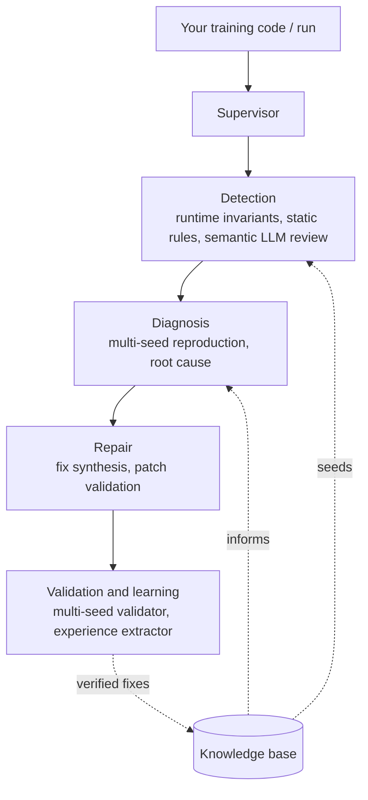

# silent-bug-agent

An open-source agent that **detects, diagnoses and fixes silent bugs in deep
learning training**: the kind where the code runs without errors, the loss even
goes down, and the model still doesn't learn what you think it does.

> **Status: early development.** The foundation (bug taxonomy + runtime
> invariants) is built and tested. Detection beyond that, diagnosis, repair and
> learning are planned, not built. See [Project status](#project-status) for
> exactly what works today.

## Why this exists

Crashes are easy: you get a traceback. Silent bugs are not. Examples:

- `model.eval()` never called before validation, so BatchNorm and Dropout keep
  behaving as in training
- a layer that is trainable but was left out of the optimizer, so it never updates
- `optimizer.zero_grad()` missing, so gradients accumulate across batches
- softmax applied before `CrossEntropyLoss`
- features and labels shuffled independently
- missing input normalization, or a learning rate that is far too high

Nothing raises. You just get a worse model and a long debugging session. This
project aims to automate that session.

## Project status

| Phase | What it is | Status |
|---|---|---|
| 0 | Bug taxonomy + runtime invariant library | **Built, 13/13 tests passing** |
| – | PyTorch adapter + test bench (`examples/`) | Written, **not yet run against real torch** |
| 1 | PyTorch hooks, live runtime monitor | Not started (the adapter is a stopgap) |
| 2 | Static analyzer + semantic (LLM) analyzer | In progress: shared report format (`findings.py`) only |
| 3 | One-batch-overfit and multi-seed validation | Planned |
| 4 | Root-cause diagnosis | Planned |
| 5 | Fix synthesis and patch validation | Planned |
| 6 | Learning loop (experience → knowledge base) | Planned |
| 7 | Meta-evolution of prompts/workflows | Planned (research track) |

"Built" means implemented and covered by the tests in `tests/`. Nothing in this
repo has been validated on real-world training code yet.

## Architecture



Design principles:

- **Statistical, not formal.** Training is stochastic: loss does not decrease
  monotonically even in a correct run. So correctness is checked with tolerances,
  rolling windows and hypothesis tests, not proofs. An earlier design used
  Lean4/Coq specs and an SMT-based patch verifier; both were dropped because
  they don't fit the problem.
- **Empirical validation.** A fix counts as verified only if it passes real runs
  (one-batch overfit, then multiple seeds compared as distributions), never a
  single run.
- **Small knowledge base that grows.** It starts from the hand-written taxonomy
  and grows from fixes the tool actually verifies. No large pre-existing dataset
  is assumed.
- **Framework-agnostic core.** The invariants operate on a plain `TrainingState`
  snapshot and never import torch. PyTorch is one adapter on top.

## Quick start (what works today)

Requires Python 3.9+ (developed on 3.12; other versions untested).

```bash
git clone https://github.com/<your-username>/silent-bug-agent.git
cd silent-bug-agent
python -m venv .venv && source .venv/bin/activate   # Windows: .venv\Scripts\activate
pip install -r requirements.txt

python examples/demo_invariant_check.py     # synthetic scenarios, no torch needed
python -m pytest tests/ -v                  # or: python tests/test_invariants.py
```

If you only want the invariant library and not torch, `pip install pyyaml` is
enough for the demo and the tests.

### Try it on a real PyTorch model

`torch` and `torchvision` are in `requirements.txt`. Install the build that
matches your hardware from [pytorch.org](https://pytorch.org/get-started/locally/)
first if you need CUDA.

```bash
python examples/planted_bugs_torch.py --bug none    # baseline: expect no critical failures
python examples/planted_bugs_torch.py --bug all     # tiny model with each bug planted in turn
```

> These two scripts were written without access to torch and have **not been run
> against it**. If a result surprises you, treat it as "investigate", and please
> open an issue with the output.

### Test your own training script

Open `examples/planted_bugs_torch.py` and paste your script into the
**CUSTOM CODE SECTION** near the top (no indentation needed). Keep or add two
lines, `collector = TorchStateCollector(model)` after the model is built and
`check(collector, loss)` right after `optimizer.step()`. Then run:

```bash
python examples/planted_bugs_torch.py --bug custom
```

The section's comments explain the details. Crashes (shape errors and the like)
happen before there is anything to monitor; this tool targets silent bugs.

To wire the invariants into your own loop directly, see the usage notes at the
top of `examples/torch_adapter.py`.

## Phase 0 in detail

**Taxonomy** (`silent_bug_agent/taxonomy/bug_taxonomy.yaml`): 20 seed bug
patterns, each with symptoms, a category, whether it is detectable statically /
at runtime / semantically, a typical fix, and links to the invariants that can
catch it. Categories draw on published empirical studies of real DL bugs
(Islam et al. 2019; Humbatova et al. 2020) plus common training-debugging
practice. It is a starting set, not a complete one. 12 of the 20 currently have
a runtime invariant; the rest need static or semantic analysis.

**Invariants** (`silent_bug_agent/invariants/`): five checks over a `TrainingState`.

| Invariant id | Catches |
|---|---|
| `gradient_norm_bounds` | exploding or vanishing gradients, NaN gradients |
| `frozen_weights` | a trainable parameter that stops changing |
| `train_eval_mode_mismatch` | BatchNorm/Dropout in the wrong mode for the phase |
| `activation_health` | NaN/Inf activations, mostly-dead units |
| `loss_trend` | loss not improving over a window (deliberately *not* a monotonic check) |

Check how much of the taxonomy is covered:

```python
from silent_bug_agent.taxonomy import load_taxonomy, coverage_report
print(coverage_report(load_taxonomy()))
```

## Repository layout

Items marked *(planned)* do not exist yet.

```
silent-bug-agent/
├── README.md
├── requirements.txt
├── .gitignore
├── silent_bug_agent/                 # the package
│   ├── __init__.py
│   ├── findings.py                   # shared bug-report format (Phase 2)
│   ├── invariants/                   # Phase 0: runtime invariant checks
│   │   ├── __init__.py
│   │   ├── base.py                   #   TrainingState, Invariant, Severity
│   │   ├── gradient.py
│   │   ├── weights.py
│   │   ├── mode.py
│   │   ├── activation.py
│   │   ├── loss.py
│   │   └── registry.py
│   ├── taxonomy/                     # Phase 0: known silent-bug catalogue
│   │   ├── __init__.py
│   │   ├── bug_taxonomy.yaml
│   │   └── loader.py
│   ├── runtime/                      # (planned) Phase 1: PyTorch hooks
│   ├── static/                       # (planned) Phase 2: AST-based rules
│   ├── semantic/                     # (planned) Phase 2: LLM reviewer
│   ├── validation/                   # (planned) Phase 3: overfit + multi-seed
│   ├── diagnosis/                    # (planned) Phase 4: root cause
│   ├── repair/                       # (planned) Phase 5: fix synthesis
│   ├── learning/                     # (planned) Phase 6: experience extraction
│   ├── meta/                         # (planned) Phase 7: meta-evolution
│   └── cli.py                        # (planned) scan / monitor entry point
├── examples/
│   ├── demo_invariant_check.py       # synthetic scenarios, no torch
│   ├── torch_adapter.py              # stopgap TrainingState collector for torch
│   ├── planted_bugs_torch.py         # test bench + CUSTOM CODE section
│   └── sample_scripts/               # (planned) buggy/clean scripts for Phase 2
├── tests/
│   └── test_invariants.py
└── docs/                             # (suggested) architecture notes, diagrams
```

When Phase 1 lands, `torch_adapter.py` moves into `silent_bug_agent/runtime/`.

## Roadmap

No dates, each phase is independently useful before the next depends on it.

1. **Phase 1, live runtime monitor.** Proper PyTorch hooks populate
   `TrainingState` every step; violations become alerts with a reproducible trace.
2. **Phase 2, static + semantic detectors.** An AST-based analyzer (Python's
   stdlib `ast`) for code-level patterns from the taxonomy, and an LLM reviewer
   for intent mismatches. Both emit the common `Finding` format.
3. **Phase 3, validation oracle.** One-batch-overfit test and multi-seed
   reproduction, comparing metric distributions rather than single runs.
4. **Phase 4, root-cause diagnosis.** A small knowledge graph seeded from the
   taxonomy; statistical specs checked against the Phase 3 runs.
5. **Phase 5, repair.** LLM + retrieval fix synthesis; every candidate patch is
   validated with Phase 3 runs and a benchmark regression check.
6. **Phase 6, learning loop.** Verified repairs are logged into the knowledge
   base; a contextual bandit picks which repair strategy to try first.
7. **Phase 7, meta-evolution** (research track). Automated prompt and workflow
   search, only once there is real outcome data.

## Known limitations

- Thresholds (gradient bounds, 90-step loss window, frozen-weight patience) are
  **untuned defaults** and will produce false positives on some architectures.
- Runtime invariants cannot see data bugs (label misalignment, leakage), a wrong
  loss for the task, or missing normalization. Those need Phases 2 and 4.
- Activation hooks see `nn.ReLU()` modules but not functional calls like
  `F.relu(...)` or `torch.relu(...)`.
- The mode check matches module names against substrings like "batchnorm"; the
  adapter works around this by including the class name in each key. Phase 1
  should replace the substring match with a real type field.
- The adapter keeps a second copy of the weights and synchronizes the GPU on
  every snapshot; snapshot every N steps on large runs.
- Scripts in `examples/` import each other by path rather than via an installed
  package (no `pyproject.toml` yet).

## Contributing

The easiest contribution is a **new taxonomy entry** for a silent bug you have
hit. Add it to `silent_bug_agent/taxonomy/bug_taxonomy.yaml` following the
schema at the top of that file, and run the tests: `test_taxonomy_loads_and_validates`
catches duplicate ids, missing fields and invalid categories.

To add an invariant: create a subclass of `Invariant` in
`silent_bug_agent/invariants/`, register it in `registry.py`, reference its `id`
from the relevant taxonomy entries, and add tests that cover both the pass and
the fail case.

## Related work

- Islam et al., *A Comprehensive Study on Deep Learning Bug Characteristics* (2019)
- Humbatova et al., *Taxonomy of Real Faults in Deep Learning Systems* (2020)
- **TrainCheck**, which infers training invariants to catch silent errors; the
  closest existing work to the runtime side of this project

## License

Not yet chosen. Add a `LICENSE` file before publishing (MIT and Apache-2.0 are
common choices for open-source ML tooling).
